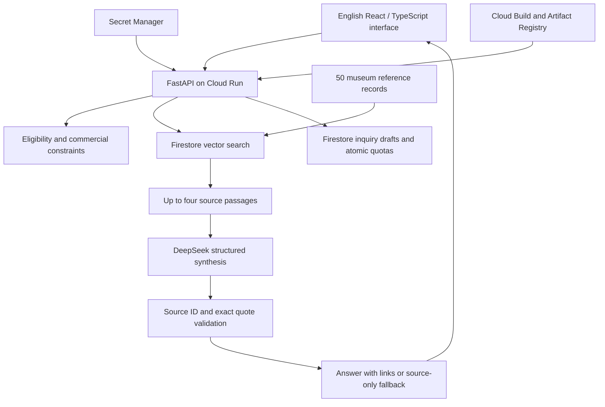

# HAHA Heritage Studio · 飞颐礼遇

**An English-first heritage discovery product: sourced cultural answers, explicit buying constraints, and saved inquiry drafts.**

[Live product](https://haha-studio-201693996482.us-central1.run.app/) · [Three-minute demo](docs/WEB_DEMO_SCRIPT.md) · [Architecture & tradeoffs](docs/WEB_PRODUCT_AND_FDE.md) · [Deployment runbook](docs/WEB_RUNBOOK.md) · [Verified release record](docs/WEB_IMPLEMENTATION_STATUS.md)

> **1st place · 一等奖 — Cultural Export Scenario Track (文化出海场景赛道)**, October 2026
> 滴水湖全球OPC人工智能挑战赛——雪窦山AIGC品牌出海赛道
> Prize: ¥30,000 cash plus ¥30,000 in compute credits. The award records the
> month, not a day.
>
> **3rd place — S3 Final · Buildathon**, 21 August 2026
> Dishui Lake Global OPC AI Challenge & The 2nd Yanyuan "Xiechuangzhe" AI+ International Entrepreneurship Competition
>
> **Selected for incubation and investment at Shanghai Lingang New Area.**
> Terms are still being negotiated as of 21 August 2026 and nothing has been
> disbursed; this line will be made specific once an agreement is signed.

Built with **React, TypeScript, Python, FastAPI, DeepSeek, Firestore vector search, Docker and Google Cloud Run**. This release takes the original Streamlit prototype through a separate web/API implementation, cloud deployment and live acceptance testing.

**Verified:** live DeepSeek responses with checked citations, inquiry persistence across reloads and isolation between browser workspaces (November 1, 2026). The November 2 ADK release passes **436 main-suite tests plus 11 isolated ADK/worker tests** in Linux CI; see the validation record below.

> **MVP demo data / MVP 演示数据.** Museum objects are cultural references, not inventory. Prices and fulfillment details are demo assumptions. Saved inquiries are drafts, not orders or messages to merchants. This is a deployed functional prototype, not a claim of customer adoption or production-scale operation.

## The problem and the delivered workflow

An overseas buyer needs understandable cultural context, a source they can inspect, and a brief a merchant could act on. The product hypothesis is that connecting these steps reduces ambiguity. Customer discovery and business impact have not yet been measured.

1. **Describe an interest** in English, such as “Explain blue and white porcelain.”
2. **Set concrete constraints:** CNY budget per item, quantity, time available and shipping needs.
3. **Inspect a sourced answer:** retrieved museum references accompany DeepSeek observations.
4. **Review eligible gift concepts:** deterministic rules govern commercial constraints.
5. **Save a draft with consent:** revisit it after a reload or export it as JSON.

Try the [live product](https://haha-studio-201693996482.us-central1.run.app/) with a CNY 1,200 budget, 10 items and 30 days. Open **Request evidence** to inspect retrieval/generation timings, token usage and the request ID. No account is required.

## Forward-deployed engineering evidence

The work below is relevant to the [Google Forward Deployed Engineering Intern, Summer 2027 role](https://www.google.com/about/careers/applications/jobs/results/75665705386549958-forward-deployed-engineering-intern-bsms-summer-2027). Each entry links to an implementation or a reproducible result.

| Capability | What this project demonstrates | Evidence |
| --- | --- | --- |
| Python application engineering | Typed APIs, input validation, deterministic eligibility and explicit failures | [API](src/heritagelink/web/app.py), [schemas](src/heritagelink/web/schemas.py), [rules](src/heritagelink/recommender.py) |
| Cloud AI delivery | React/FastAPI container built in Cloud Build, deployed to Cloud Run, with Secret Manager and scoped IAM | [Dockerfile](deploy/gcp/Dockerfile.web), [build configuration](deploy/gcp/cloudbuild.web.yaml), [runbook](docs/WEB_RUNBOOK.md) |
| Bounded agent workflows | Google ADK graph orchestration, per-invocation isolation, deterministic review/revision, private service authentication and request quotas | [ADK integration](docs/ADK_CAMPAIGN_LOOP.md), [worker](src/heritagelink/adk_worker.py) |
| Structured and unstructured data | Validated commercial CSV records combined with museum prose and a versioned vector index | [data loader](src/heritagelink/data_loader.py), [catalogue](src/heritagelink/catalog.py), [vector retrieval](src/heritagelink/vector_search.py) |
| RAG and output validation | Retrieve evidence, synthesize a structured answer, validate source IDs and quotations, fall back when necessary | [RAG service](src/heritagelink/web/service.py) |
| State and integration reliability | Durable session-owned drafts, transactional request budgets, idempotent saves and failure reporting | [persistence](src/heritagelink/web/store.py), [API tests](tests/test_web.py) |
| Evaluation and observation | Regression tests, an offline retrieval smoke set, request IDs, stage timings and token counts | [evaluation script](scripts/evaluate_web_rag.py), [results](docs/web-retrieval-evaluation.json), [live acceptance](docs/WEB_IMPLEMENTATION_STATUS.md) |

This evidence supports discussion of implementation and delivery; it does not establish all hiring qualifications. The cultural RAG path uses a single bounded model call. The separate [Draft Studio](docs/ADK_CAMPAIGN_LOOP.md) integrates Google ADK Workflow for drafting, rule-based review and bounded revisions, with human acknowledgement before local export. Its release evidence distinguishes local verification from live deployment. This does not claim two independent LLM reviewers, customer-led discovery sessions, measured ROI, or a Google model integration. GCP hosts the application; DeepSeek supplies generation.

## Architecture



The compiled frontend and API share one origin and one container. SQLite supports local development; Firestore provides cloud persistence. The model cannot write inquiries, change eligibility or set commercial terms.

### Decisions that matter

- **Explainable retrieval.** Versioned, 256-dimensional lexical feature hashing—not learned semantic embeddings. English stop words are removed and explicit material terms constrain matches. This is a small-corpus baseline; synonym coverage and broader relevance remain limitations.
- **Validation outside the model.** Source IDs must exist in the retrieved set; quotations must occur exactly in the supplied passage. URLs come from the server registry. Invalid output is withheld. These checks do not prove semantic entailment.
- **Independent business rules.** Eligibility and commercial hard filters run in Python. A concept's minimum price must fit the budget; if its upper price exceeds the budget, the UI warns that some configurations cost more. No model-generated price is accepted.
- **Visible failure behavior.** No retrieved evidence means no model request. Provider failure or rejected output produces source-only results. Storage failure returns an error rather than pretending an inquiry was saved.
- **Bounded model usage.** One provider call, a 25-second timeout, a 1,400-output-token cap and no automatic paid retry. Persistent quotas allow 10 advice requests per browser/day and 100 globally/day. Resettable cookies are not strong identity controls.
- **Workspace protection.** Random HttpOnly, SameSite cookies identify anonymous sessions; cloud cookies use Secure. Writes check origin and require a custom header. Inquiries require consent and server-side eligibility checks. Keys stay server-side.

## Validation: automated checks and live acceptance

| Check | Recorded result | Interpretation |
| --- | --- | --- |
| Main Python regression suite | **436 passed, 2 skipped** | Linux CI; optional ADK tests run in their own dependency environment |
| ADK/worker suite | **11 passed** | Actual Workflow scheduling, bounded revisions, concurrency isolation, fallback and fact-input validation |
| Web/API and worker-proxy tests | **17 passed** | Included in the main suite; citation rejection, fallback, ownership, consent, quotas and audience-bound authentication |
| English retrieval smoke set | **12/12 passed** | Hand-authored in-domain cases; term presence in the top three passages or expected abstention—not answer accuracy |
| Frontend | TypeScript check and Vite production build passed | Compiled English UI |
| Python quality checks | Changed-file Ruff lint and format passed | Whole-repository checks retain 175 existing lint findings and 20 formatting findings in the separate data-engineering project |
| Live Cloud Run acceptance | Successful synthesis, source page check, saved draft after reload, separate-browser isolation | End-to-end behavior checked November 1, 2026 |
| ADK release acceptance | Real DeepSeek draft, ADK stage history, museum source and acknowledgement gate; existing RAG and inquiry reload rechecked | [November 2 release record](docs/ADK_RELEASE_2026-11-02.md), including download-verification limitation |

One live request (`e01a66544aca4546`) retrieved four sources in **216 ms** and generated an answer in **6,710 ms**, using **528 input / 116 output tokens**. These are single-request observations, not percentile latency benchmarks. Token counts are available for billing analysis; cost per request and provider-only tokens/second are not currently calculated. Logs omit question text, inquiry notes, cookies and keys.

Reproduce the [retrieval evaluation](scripts/evaluate_web_rag.py), inspect the [API tests](tests/test_web.py), and review the [passing ADK release CI](https://github.com/Hahazehua/feiyi-heritage-ai/actions/runs/41466773777). Mocked provider tests and live model checks are distinct.

## Stack

| Layer | Technology |
| --- | --- |
| Web interface | React, TypeScript, Vite, CSS, Lucide icons |
| API and domain logic | Python 3.11+, FastAPI, Pydantic, Uvicorn |
| Generation | DeepSeek API via the OpenAI-compatible client; deployed model `deepseek-flash` |
| Draft orchestration | Google ADK 2.13 Workflow and Runner; private Cloud Run worker, rule-based Guardian and human acknowledgement before export |
| Retrieval | Firestore vector search, 256-dimensional lexical feature hashing |
| State | Firestore in cloud; SQLite locally |
| Delivery | Docker, Cloud Build, Artifact Registry, Cloud Run |
| Secrets and access | Secret Manager, IAM, database-conditioned runtime data access |
| Quality and versioning | pytest, Ruff, Git, GitHub |

## Run locally

Use Python 3.11+ and Node.js 22+. Create an environment in this checkout so imports do not resolve to a sibling repository.

```bash
python -m venv .venv
# macOS/Linux:
source .venv/bin/activate
# Windows PowerShell instead: .\.venv\Scripts\Activate.ps1
python -m pip install -e '.[gcp,web,dev]'
cd web
npm ci
npm run build
cd ..
python -m uvicorn heritagelink.web.app:app --host 127.0.0.1 --port 8080
```

Open <http://127.0.0.1:8080>. SQLite and source-only mode work without cloud credentials or an API key. To enable generation, set `LLM_ENABLED=true` and `DEEPSEEK_API_KEY` in the server process environment; never commit the key. See the [runbook](docs/WEB_RUNBOOK.md) for cloud settings and deployment details.

```bash
python -m pytest
python -m ruff check .
python -m ruff format --check .
python scripts/evaluate_web_rag.py
```

## Catalogue and provenance

The commercial demo catalogue and the retrieval corpus are related but distinct. The following counts are checked against the CSVs by [documentation tests](tests/test_readme_catalog_table.py).

| Metric | Current |
|---|---:|
| Catalogue records | 54 |
| Recommendation-eligible | 23 |
| Museum or cultural reference | 30 |
| Partner-supplied, pending verification | 4 |
| Bilingual content records | 108, i.e. 54 per locale |
| Category coverage | 11 |
| Data quality | 54 records, all Level C demo data |
| Verified merchants | 1 (安徽飞颐文化有限公司, supplying 4 partner works) |

Categories: `bamboo`, `calligraphy`, `ceramics`, `fan`, `iron_painting`, `jade`, `lacquer`, `seal`, `tea`, `textile`, `woodblock`.

The retrieval corpus contains **50 museum reference records**. Museum attribution and image-license metadata are retained with each record. The four partner-supplied works are not museum records; three have generatively edited photographs labelled in the dataset. Merchant verification does not verify every product claim. Museum sources do not imply museum endorsement, and commercial demo prices are not museum facts.

## Deployment and operating boundaries

The public web release runs on GCP Cloud Run in `us-central1`, with minimum zero and maximum one instance, 512 MiB memory, one vCPU and concurrency four. The verified revision is `haha-studio-00001-6fh`. Database write access is conditioned on the default Firestore database; Secret Manager supplies the existing DeepSeek key.

- Browser workspaces are anonymous, not authenticated accounts. Cookie access lasts up to 30 days; records are retained until operator cleanup, not deleted at cookie expiry.
- The prototype does not send merchant messages, process payments or guarantee delivery.
- Customer adoption, revenue and business impact are not established.
- Free-tier allowances are not a zero-cost guarantee. Builds, registry storage, Firestore, logs and DeepSeek have separate usage and billing considerations.
- The runtime image reuses an existing project-specific image. For another GCP project, follow the base-image instructions in the runbook rather than assuming public access.

Next work: held-out retrieval and human factuality evaluation; observed buyer discovery sessions; verified accounts and deletion/retention controls; stronger abuse protection; latency distributions and explicit per-request cost measurement.

## Earlier prototype and project history

The [Streamlit prototype](https://haha-vector-demo-uv6mvvajyq-uc.a.run.app/?lang=en) remains separate. It includes artisan, Growth Studio and Story Studio workflows that are **not part of the new web release**. Historical architecture, competition context and earlier hosting notes are retained in [README_STREAMLIT.md](README_STREAMLIT.md). Those notes are a snapshot, not the current web deployment specification.

For the complete engineering narrative, see [product decisions](docs/WEB_PRODUCT_AND_FDE.md), the [demo script](docs/WEB_DEMO_SCRIPT.md) and [release evidence](docs/WEB_IMPLEMENTATION_STATUS.md).
