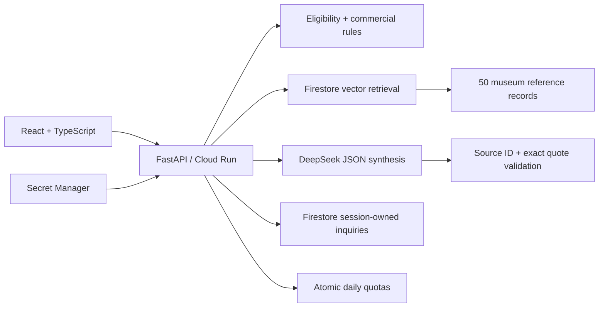

# HAHA Heritage Studio — product and engineering case study

## Problem and discovery assumptions

An overseas gift buyer may struggle to understand unfamiliar Chinese craft and distinguish
museum evidence from an actual commercial offer. A merchant needs a concrete brief, not an
unqualified AI promise. These are **product hypotheses**, not findings from customer interviews.
The first release tests the journey: discover a craft → inspect evidence → constrain a gift
concept → save a draft inquiry. No revenue, conversion improvement or customer ROI is claimed.

English is the primary interface. Prices are explicitly in CNY. Museum objects are not for sale;
commercial prices, capacities and lead times are labelled MVP demo data.

## Architecture



One container serves the compiled frontend and API. This avoids cross-origin credentials and a
second idle service. The existing Streamlit demo remains independently deployable.
Local development uses SQLite; the deployed service uses Firestore. Queries are not stored in
the vector index. Only explicitly saved briefs and notes enter inquiry persistence.

## AI contract and limitations

The existing 256-dimensional feature-hashed lexical vectors are versioned and reproducible.
They are **not learned semantic embeddings**. English stop words are removed and explicit
material terms constrain retrieved references and eligible gift concepts. The corpus is small;
retrieval currently reads the bounded catalogue to preserve deterministic ordering. This is not
a large-scale architecture claim. A learned multilingual embedding benchmark is future work.

DeepSeek receives only the question and at most four public source passages. It cannot call tools,
write inquiries or change price constraints. Every returned claim requires a known source ID
and an exact supporting quote. URLs come from the server registry. Unknown IDs, fabricated
quotes, model URLs, malformed JSON and truncated generations fail closed to source-only display.
These checks do **not** prove semantic entailment or prevent every prompt-injection attempt.
The UI labels generated interpretation and allows the user to inspect evidence.

Retrieval without evidence makes no model request. Provider failures retain source cards.
There are no automatic paid retries. One synthesis call has a 25-second timeout and 1,400 output
token cap. Atomic quotas bound advice to 10 requests/browser/day and 100 globally/day; inquiry
writes to 20/browser/day and 200 globally/day. Browser cookies are resettable, so the global
budget is the primary spending boundary, not an identity-based anti-abuse guarantee.

## Persistence and privacy

A 256-bit random HttpOnly, SameSite=Strict cookie identifies an anonymous workspace; only its
SHA-256 digest names the database path. Cloud cookies use Secure. This is capability access,
not authenticated user identity. Cross-origin writes are rejected and require a custom header.
Inquiry creation rechecks eligibility on the server and requires explicit consent. Idempotency
keys prevent duplicate records; changed contents with an existing key return HTTP 409.
Storage failures return HTTP 503 and are never shown as successful saves.

Cookie lifetime is 30 days. Records are retained in the demo database until operator cleanup;
cookie expiry does not automatically delete records. Avoid personal/confidential information.
Quotas have an expiry field for future lifecycle maintenance; Firestore TTL is not assumed enabled.
Anonymous workspaces lack recovery and cross-device access; JSON export is available. No email,
merchant submission, order, payment or fulfillment happens in this release.

Structured logs include random request IDs, route, HTTP status, timings, retrieval backend,
generation state and token counts. They exclude prompts, notes, cookies and keys. Tokens/request
and client-observed provider latency are reported; dollar cost and provider-only throughput are
not invented. Infrastructure and model billing remain separate.

## Evidence and target-role mapping

Target: [Google Forward Deployed Engineering Intern, BS/MS, Summer 2027](https://www.google.com/about/careers/applications/jobs/results/75665705386549958-forward-deployed-engineering-intern-bsms-summer-2027).

| Role-relevant skill | Reviewable project evidence |
| --- | --- |
| Python and end-to-end cloud AI | FastAPI request flow, Cloud Run container and deployment runbook |
| Structured/unstructured data and RAG | Validated commercial CSVs, museum prose, vector index, cited synthesis |
| Reliability and evaluation | API tests, offline retrieval benchmark, explicit failure states |
| Operational observation | Per-request timings, token counts, structured logs and daily budgets |
| Translating needs into delivery | Buyer brief, hard constraints, consent and durable inquiry export |

The role also values customer-facing discovery and broader agent experience. This project does
not claim real customer engagements or multi-agent orchestration. Interviewers can inspect the
tradeoffs and run the implementation; this does not establish every hiring qualification.

## Reproduce evaluation

```powershell
$env:PYTHONPATH = 'src'
python -m pytest
python -m ruff check .
python -m ruff format --check .
python scripts/evaluate_web_rag.py
cd web
npm ci
npm run build
```

The retrieval smoke set has 12 hand-authored English cases. Success is expected-term presence
within the first three passages, or abstention for the two unsupported queries. It is deliberately
a narrow regression metric, not an estimate of real-world answer correctness or user value.
Provider tests use mocked responses; live model validation is recorded separately in release notes.

Next discovery work: observe five target users completing a brief; record misunderstood concepts,
source clicks, task completion and merchant clarification needs. Define a held-out query set and
human-reviewed factuality rubric before making quality or conversion claims.
